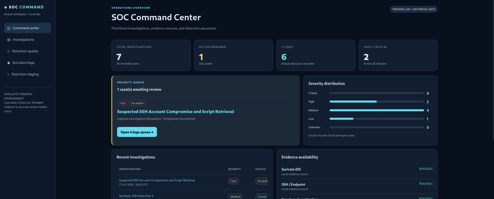
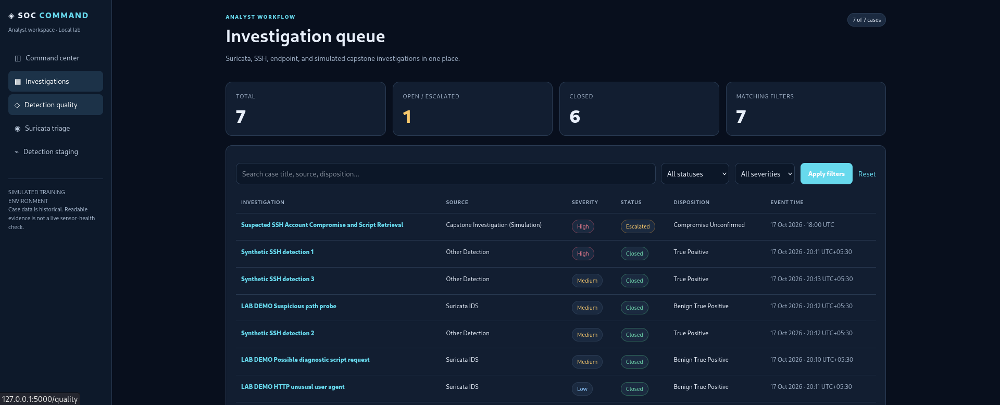
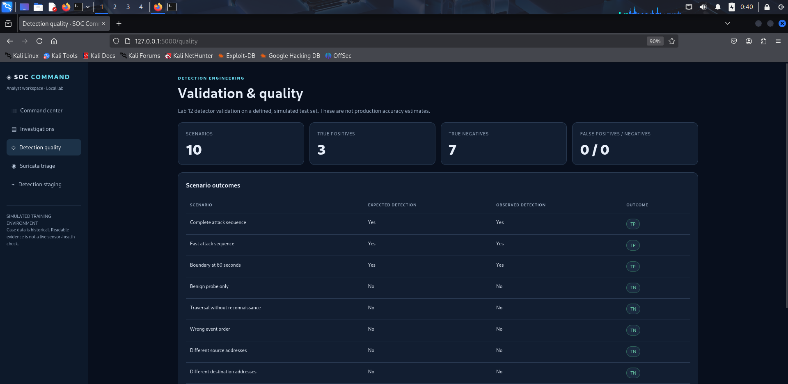
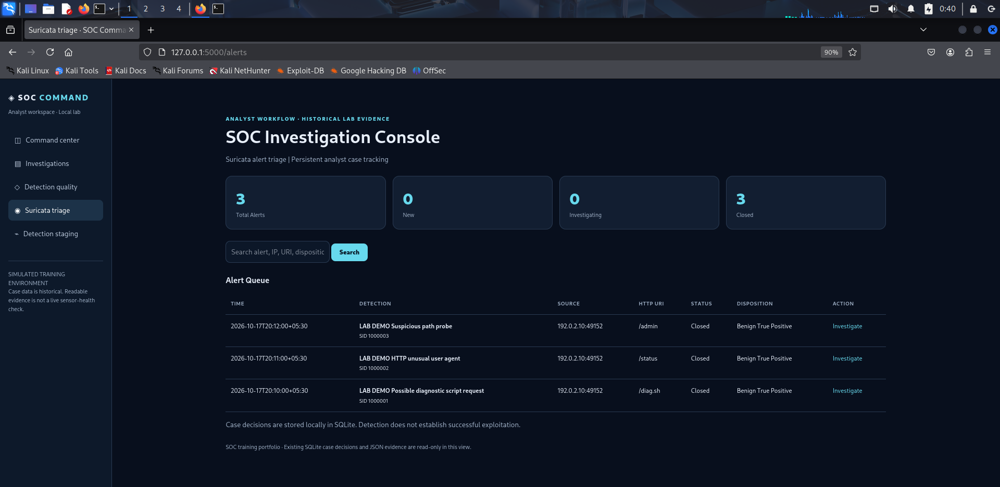
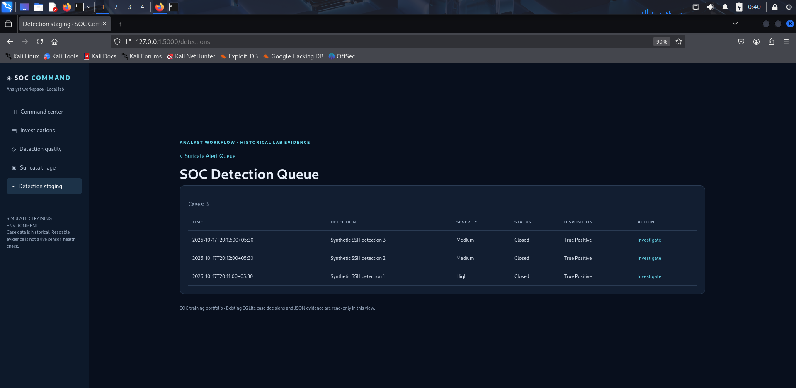

# SOC Home Lab — SOC Command v3.1

A Kali Linux / VirtualBox SOC analyst training project comprising twelve exercises and a simulated incident-response capstone. The dashboard uses Flask, SQLite, Suricata EVE alert records, SSH/endpoint detection staging, and controlled detector validation.



## Key features

- Flask dashboard with SOC overview, investigation queue, detection quality, and case detail views.
- Suricata alert triage and SSH/endpoint detection staging with analyst status, disposition, and notes.
- Simulated incident-response capstone with a unified timeline and evidence-based conclusions.
- Controlled detector validation across 10 synthetic scenarios (3 TP, 7 TN, 0 FP, 0 FN); these are **not** production performance metrics.
- Standalone smoke test for six dashboard routes and three synthetic Suricata alerts.

## What is included

- `dashboard/`: SOC Command source and investigation workflow
- `evidence/`: **synthetic demo** Suricata EVE records and detection staging SQLite database
- `dashboard/cases.db`: **synthetic demo** Suricata case decisions
- `capstone/`: selected training investigation evidence and report
- `validation/`: controlled detector-quality results
- `tests/`: standalone demo smoke test

The demo cases are **not** copies of original lab databases. The capstone is a simulation: compromise and script execution were **not confirmed**. The 3 TP / 7 TN / 0 FP / 0 FN results describe ten controlled test scenarios only, not real-world accuracy.

## Safety and limitations

- **Local demonstration only.** The app binds to `127.0.0.1` by default and runs with debug mode disabled. Do not publish it to the internet or use it with untrusted users.
- The case-update forms do **not** currently implement CSRF protection or user authentication. Do not deploy the Flask development server as a public service.
- The repository includes intentionally tracked **synthetic demo SQLite databases**. Do not replace them with real case databases, credentials, raw customer logs, or private telemetry.
- The capstone is simulated; unauthorized access, script execution, persistence, and exfiltration were **not** established.
- Review all screenshots and evidence for sensitive information before sharing. The checks documented here are **not** a comprehensive security audit.

## Beginner's guide: from download to SOC investigation

This guide assumes Kali Linux (including Kali in VirtualBox). All commands are run in the **Kali terminal**. The included dashboard works without installing or running Suricata because it ships with **three synthetic sample alerts**.

### Step 1 — Install the basics

```bash
sudo apt update
sudo apt install -y git python3 python3-venv python3-pip
```

### Step 2 — Download the project

```bash
cd ~
git clone https://github.com/irushimelettu-sudo/soc-home-lab.git
cd soc-home-lab
```

If you already cloned the project, use `cd ~/soc-home-lab` instead of cloning it again.

### Step 3 — Create a Python environment and install dependencies

```bash
python3 -m venv .venv
source .venv/bin/activate
pip install -r requirements.txt
```

The `(.venv)` prefix in the terminal means the environment is active.

### Step 4 — Check the demo before starting

```bash
python3 tests/smoke_test.py
```

Expected: six `[PASS]` route checks, `[PASS] 3 synthetic Suricata alerts`, and `[COMPLETE] Standalone smoke test passed`. This is a basic functionality check, not a production security test.

### Step 5 — Start the SOC dashboard

```bash
python3 dashboard/app.py
```

Keep this terminal open. In Kali's browser, visit **http://127.0.0.1:5000/**. Stop the server with **Ctrl+C**. When finished, type `deactivate` to exit the Python environment.

### Step 6 — Act as a SOC analyst

1. **Overview** (`/`): explain what the dashboard tracks.
2. **Suricata alerts** (`/alerts`): select one of the three synthetic sample alerts. Read its signature, severity, timestamp, source/destination and HTTP URI when available.
3. **Investigate**: open the alert's case, set its status to **Investigating**, record a disposition such as **Needs Investigation**, and write a note explaining what you observed and what evidence you would seek next. Save the case; decisions are stored in local SQLite.
4. **Investigation queue** (`/investigations`): review case progress.
5. **Detection queue** (`/detections`): examine the separate SSH/endpoint detection examples and document your reasoning.
6. **Capstone** (`/capstone/CAPSTONE-001`): walk through the simulated SSH timeline: failed logins, a successful login, a subsequent `curl` command and HTTP script retrieval. Explain that **compromise and script execution were not confirmed**.
7. **Detection quality** (`/quality`): discuss 3 true positives, 7 true negatives, 0 false positives and 0 false negatives across **10 controlled synthetic scenarios**, not live-world performance.

A useful analyst note answers: **What happened? What evidence supports that assessment? What is still unknown? What should happen next?** Do not mark an alert malicious solely because a detection rule fired.

## How the included alerts were prepared (beginner explanation)

**Important:** The dashboard's three alerts are **preloaded synthetic examples**. They are not generated each time the Flask app starts, and they are not proof of attacks on a real network.

Here is the data flow behind the published project:

1. **Understand the detection source.** Suricata is a network intrusion detection system (IDS). It examines traffic and, when a configured rule matches, can write an alert event in **EVE JSON** format. An alert is a rule match, not automatically proof of malicious activity.
2. **Prepare safe example evidence.** For this public portfolio, sample Suricata-format alert records were prepared as **synthetic training data**, rather than publishing private packet captures or original raw logs. The included files are `evidence/suricata-retest/eve.json` and `evidence/attack-tests/suricata-fixed/eve.json`. The exact original traffic-generation commands for every bundled synthetic record are **not documented**, so do not claim each one was recreated live.
3. **Load the examples into the dashboard.** In `dashboard/app.py`, the `SOURCES` list points to those two files. The `load_alerts()` function reads each JSON line, keeps events where `event_type` is `alert`, and extracts the timestamp, rule signature, signature ID, severity, IPs, ports, and HTTP URI when present.
4. **Give each alert a case identity.** The dashboard uses the evidence-file path and line number to identify an alert. This lets an analyst open and track a specific record.
5. **Investigate and save decisions.** In `/alerts`, review the evidence. Open the case, choose **Investigating** and **Needs Investigation**, write your reasoning, and save. Case status, disposition, and notes are stored in a local SQLite database.
6. **Explain what you know and do not know.** A rule firing means its conditions matched. Confirming an intrusion requires additional context and corroborating evidence.

### Practice an investigation without generating any traffic

After completing Steps 1–5 above:

1. Open **http://127.0.0.1:5000/alerts** and select an existing sample alert.
2. Read its **signature** (what the rule identified), **severity** (the rule's priority), **timestamp** (when the event is recorded), **source/destination** (where the traffic came from and went), and **URI** if shown.
3. Ask: *Does this look suspicious? What information is missing? Could there be a benign explanation?*
4. Open the case and set its status to **Investigating**. Keep the disposition as **Needs Investigation** unless the evidence supports a stronger conclusion.
5. Write an analyst note, for example: `Reviewed Suricata signature and source/destination. Rule match observed; malicious intent not established. Next step: correlate with host and authentication logs.`
6. Save and reopen the case to show that your analyst notes persist. Then visit **/investigations** to review case progress.

### How to explain the project in an interview

> "I built a local SOC analyst training dashboard using Flask, SQLite and Suricata-format EVE JSON evidence. The public repository contains three synthetic Suricata alerts, so another person can clone the project and reproduce the investigation workflow without generating attacks. The application parses the JSON records, shows alert metadata, and lets me document case status, disposition and notes in SQLite. I also separately tested how real Suricata alerts are produced: I created a custom HTTP detection rule, validated it, sent a harmless localhost request and confirmed a new event in an EVE JSON log. That live test is not automatically connected to the published dashboard."

**Suggested 5–10 minute demonstration:** start the dashboard → show one sample alert → explain its fields → open the case and save an analyst note → show the investigation queue → explain the simulated capstone → show controlled validation results → describe the optional Suricata rule test below if asked how alerts are generated.

**Interview question: "Did you generate these exact three alerts live?"** Answer: "No. The published dashboard uses three synthetic sample alerts for reproducible analyst training. I separately demonstrated real Suricata rule matching using a harmless localhost HTTP request."

---

## Optional hands-on exercise: generate a NEW Suricata alert

**This is separate from the default dashboard.** The three bundled alerts are preloaded examples. The following exercise creates a *fresh* alert from actual HTTP traffic on your own Kali machine, saved to a separate local EVE JSON log. **The fresh alert will not automatically appear in the Flask dashboard**; live-log ingestion is not part of the published default setup.

Only run this on your own lab system. It sends a harmless HTTP request to a local web server; it is not an attack on another host.

### A — Install and check Suricata

```bash
sudo apt install -y suricata curl
suricata -V
ls -l /etc/suricata/suricata.yaml
```

Suricata 8 uses `-V` for its version. If your distribution stores the configuration elsewhere, adjust the path in the commands below.

### B — Write a custom HTTP detection rule

```bash
mkdir -p ~/soc-live-demo
cat > ~/soc-live-demo/demo.rules <<'EOF'
alert http any any -> any any (msg:"SOC LAB - Live HTTP Demo Alert"; flow:established,to_server; http.uri; content:"/soc-lab-test"; sid:1000001; rev:1;)
EOF
```

**What it means:** `alert http` creates an alert for matching HTTP traffic; `http.uri` and `content` match the request path `/soc-lab-test`; `sid:1000001` is the custom rule identifier. This is a deliberately simple learning rule, not a general malicious-traffic detector.

### C — Validate the rule

```bash
sudo suricata -T -c /etc/suricata/suricata.yaml -S ~/soc-live-demo/demo.rules
```

Look for a message indicating that the configuration was successfully loaded. Fix any errors before continuing.

### D — Start three terminals

**Terminal 1 — Suricata listening on loopback:**

```bash
sudo mkdir -p /var/log/suricata/soc-live-demo
sudo suricata -c /etc/suricata/suricata.yaml -S ~/soc-live-demo/demo.rules -i lo -l /var/log/suricata/soc-live-demo
```

Leave it running. `lo` is the local loopback interface, so this demonstration stays on the same machine.

**Terminal 2 — Harmless local web server:**

```bash
python3 -m http.server 8088 --bind 127.0.0.1
```

Leave this running too.

**Terminal 3 — Trigger a matching request:**

```bash
curl -v http://127.0.0.1:8088/soc-lab-test
```

A `404 File not found` response is **fine**: the rule matches the HTTP request URI, not the response status.

### E — Find the newly generated alert

In Terminal 3:

```bash
sudo grep 'SOC LAB - Live HTTP Demo Alert' /var/log/suricata/soc-live-demo/eve.json
```

A successful match produces a new JSON event with `"event_type":"alert"`, signature `"SOC LAB - Live HTTP Demo Alert"`, signature ID `1000001`, source and destination `127.0.0.1`, destination port `8088`, the URI `/soc-lab-test`, and a timestamp for the request. This was reproduced locally with **Suricata 8.0.7**.

If no match appears, check Terminal 1 for errors, verify the server is reachable, and repeat the `curl` request. Capture behavior may vary by operating system and interface configuration.

Press **Ctrl+C** in Terminals 1 and 2 when finished. The rule remains in `~/soc-live-demo/demo.rules` and the log remains in `/var/log/suricata/soc-live-demo/eve.json`; both are **outside the repository**. Do not commit real packet captures or sensitive live logs.

### How alert generation works, in plain English

1. A client sends an HTTP request for `/soc-lab-test` to a local server.
2. Suricata observes the traffic on the `lo` interface.
3. The custom rule matches that URL path.
4. Suricata writes an alert event to `eve.json`.
5. An analyst can inspect the signature, timestamp, IPs, ports and HTTP metadata, then explain why it fired.

**Interview explanation:** “I built a local SOC dashboard for alert triage and case tracking. Its published sample data is synthetic so anyone can practice investigations. I also validated a custom Suricata rule, generated my own local HTTP request, and verified a newly created EVE JSON alert. That live exercise is separate from the dashboard's default sample-data pipeline. My focus was understanding detection, evidence review and accurate case documentation.”

**Interview demo order (5–10 minutes):** show the overview → triage one sample alert → save an analyst note → discuss the capstone → explain detection-quality limits → optionally run the Suricata exercise above and show its fresh EVE JSON event. Be clear that the optional fresh event is **not** automatically imported into the default dashboard.

## Common questions

- **Are the dashboard alerts live?** No. The default three Suricata alerts are synthetic, preloaded examples.
- **Can I generate a new alert?** Yes, using the optional local Suricata rule and HTTP request above. Inspect it in the separate EVE JSON log.
- **Why doesn't my new alert show in `/alerts`?** The published dashboard reads the two bundled evidence files, not the optional `/var/log/suricata/soc-live-demo/eve.json` log.
- **Does a Suricata alert prove an intrusion?** No. A rule match is a starting point for investigation, not proof of compromise.
- **Can I use this as a production SIEM?** No. This is a localhost educational demo with synthetic data and without production authentication or CSRF protection.

## Training topics

01 SSH investigation; 02 auditd/endpoint; 03 Suricata and PCAP; 04 Flask dashboard (developed inside Lab 03); 05 timeline; 06 detection staging; 07 endpoint investigation; 08 dashboard enhancement; 09 Suricata correlation; 10 PCAP threat hunting; 11 incident response; 12 detector-quality validation.

## Scope and provenance

The dashboard was tested in the original Kali environment, including case update persistence using temporary SQLite copies. This repository includes *separate synthetic demo data* to support reproducibility; original packet captures, raw logs, full databases, and backups are not published. Some capstone and validation evidence is selected from the training exercise and must receive final human review before public upload.

## Dashboard Screenshots

The SOC Command dashboard uses synthetic demonstration data.

### SOC Command Center


### Investigation Queue



### Detection Quality



### Capstone Investigation



### SOC Detection Queue


